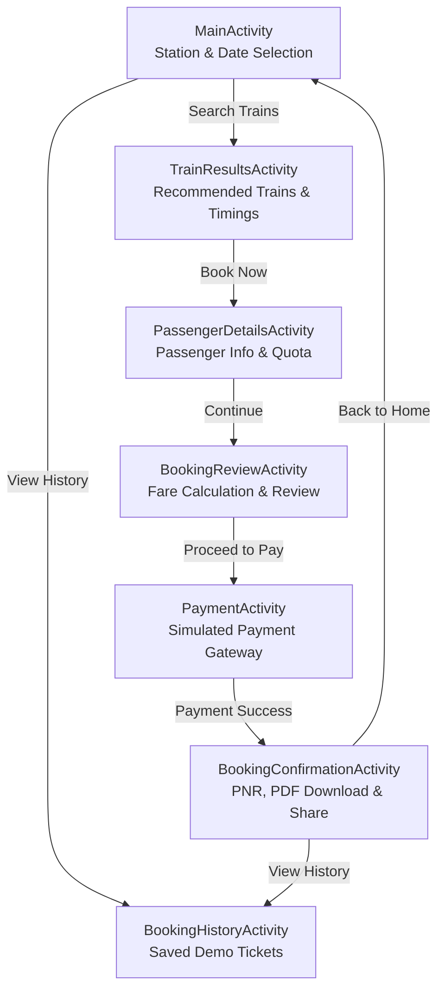

# TatkalX — Smart Railway Tatkal Booking App

> **Academic Project Submission**  
> An Android application simulating a streamlined railway Tatkal ticket booking experience, complete with passenger management, dynamic fare computation, simulated payments, PDF ticket generation, and persistent local booking history.

---

## ⚠️ Important Academic Disclaimer

> **This application is an educational and academic demonstration project.**  
> It is **NOT** affiliated with, authorized by, or connected to the Indian Railway Catering and Tourism Corporation (IRCTC), Centre for Railway Information Systems (CRIS), or Indian Railways.  
> All train schedules, availability statuses, fares, PNR numbers, and payment transactions are **simulated demo data**. No actual railway reservations are made, and no real monetary transactions take place.

---

## 📱 Project Overview

**TatkalX** is designed to address the challenges of the high-stress Tatkal ticket booking window in India by providing a clean, distraction-free, and rapid booking workflow. The app demonstrates end-to-end mobile engineering practices:

- Responsive UI design adhering to modern Android standards.
- Strict input validation for passenger details.
- Dynamic Tatkal and quota fare computation.
- Multi-channel simulated payment gateway.
- Native on-device PDF ticket generation and ticket sharing via Android Intents.
- Persistent offline booking history using Android `SharedPreferences` with duplicate prevention.

---

## 🚀 Key Features

| Feature | Description |
|---|---|
| **🚆 Train Search & Selection** | Search trains between stations with interactive date picker and route validation. |
| **📋 Train Results** | Display available trains with departure/arrival times, travel duration, and class details. |
| **👤 Passenger Information** | Input forms with validation (10-digit mobile, age limits 1–120, gender, berth preference, quota, and travel class). |
| **💳 Fare Calculation & Review** | Breakdown of base fare, Tatkal quota surcharges, and convenience fees before payment. |
| **🔒 Simulated Payment Gateway** | Demo checkout supporting UPI, Credit/Debit Cards, and Net Banking with success validation. |
| **🎟️ Booking Confirmation & PNR** | Instant generation of unique simulated PNR numbers (`TX...`) and Booking IDs (`TXB...`). |
| **📄 PDF Ticket Export** | Native Android `PdfDocument` rendering to generate printable tickets directly saved to the device's Downloads directory. |
| **📲 Share Ticket** | Instant ticket sharing via Android's native share sheet (WhatsApp, Email, SMS, etc.). |
| **📜 Booking History** | Persistent local storage via `SharedPreferences`. Displays past tickets in reverse chronological order with duplicate prevention, formatted cards, and clear history options. |

---

## 🔄 Application Architecture & Booking Flow



---

## 📁 Project Structure

```text
TatkalX/
├── app/
│   ├── build.gradle.kts                # Application build configuration
│   └── src/
│       ├── main/
│       │   ├── AndroidManifest.xml     # Application manifest & activity declarations
│       │   ├── java/com/tatkalx/booking/
│       │   │   ├── MainActivity.java               # Home search screen & navigation
│       │   │   ├── TrainResultsActivity.java       # Train listings & selection
│       │   │   ├── PassengerDetailsActivity.java   # Passenger form & input validation
│       │   │   ├── BookingReviewActivity.java      # Journey review & fare calculation
│       │   │   ├── PaymentActivity.java            # Simulated payment gateway
│       │   │   ├── BookingConfirmationActivity.java# Confirmation, PDF & share
│       │   │   └── BookingHistoryActivity.java     # Local SharedPreferences history
│       │   └── res/
│       │       ├── drawable/           # Background cards, gradients, fields & buttons
│       │       ├── layout/             # XML layouts for screens
│       │       └── values/             # Colors, themes, and string resources
├── build.gradle.kts                    # Root build script
├── settings.gradle.kts                 # Project settings & repositories
└── README.md                           # Project documentation
```

---

## 🛠️ Technology Stack

- **Language:** Java (JDK 11)
- **Platform:** Android
- **Compile SDK:** API 37 (Android 15)
- **Minimum SDK:** API 26 (Android 8.0 Oreo)
- **UI Architecture:** Android Views & View Hierarchy (XML + Programmatic UI)
- **Persistence:** Android `SharedPreferences` (JSON serialization)
- **Document Generation:** Android Native Graphics & `android.graphics.pdf.PdfDocument`
- **Build System:** Gradle (Kotlin DSL) with Android Gradle Plugin 8.9.0

---

## ⚙️ How to Build and Run

### Prerequisites
1. **Android Studio** (Ladybug, Meerkat, or newer recommended).
2. **Java Development Kit (JDK 11 or 17)**.
3. Android device or Virtual Device (AVD) running **Android 8.0 (API 26)** or higher.

### Steps
1. **Clone the Repository:**
   ```bash
   git clone https://github.com/YOUR_USERNAME/TatkalX.git
   cd TatkalX
   ```

2. **Open in Android Studio:**
   - Launch Android Studio.
   - Select **Open an existing project** and choose the `TatkalX` root folder.
   - Allow Gradle to sync dependencies.

3. **Build the Debug APK:**
   ```bash
   ./gradlew assembleDebug
   ```
   The built APK will be located at:
   `app/build/outputs/apk/debug/app-debug.apk`

4. **Build the Release APK:**
   ```bash
   ./gradlew assembleRelease
   ```
   The release APK will be located at:
   `app/build/outputs/apk/release/app-release-unsigned.apk`

5. **Run the App:**
   - Click the green **Run (▶)** button in Android Studio or deploy via ADB:
   ```bash
   adb install -r app/build/outputs/apk/debug/app-debug.apk
   ```

---

## 🧪 Evaluation & Testing Guide

To test and evaluate the full application flow:

1. **Search Trains:**
   - On the Home screen, enter a departure station (e.g., `Hyderabad`) and destination station (e.g., `Bengaluru`).
   - Select a journey date from the date picker.
   - Tap **SEARCH TRAINS →**.

2. **Select Train:**
   - On the train results screen, review the recommended trains (e.g., *Godavari Express*, *Charminar Express*).
   - Tap **BOOK NOW →** on any train card.

3. **Passenger Details:**
   - Enter passenger name (e.g., `Rahul Sharma`), age (e.g., `28`), and a valid 10-digit mobile number.
   - Select gender, berth preference, travel class (Sleeper / 3A / 2A), and quota (Tatkal / General).
   - Tap **CONTINUE TO REVIEW →**.

4. **Review & Payment:**
   - Verify the fare breakdown (notice Tatkal quota surcharge dynamically calculated).
   - Tap **PROCEED TO PAYMENT →**.
   - Choose a payment method (UPI, Card, Net Banking) and tap **PAY**.
   - Confirm the demo payment dialog by tapping **VIEW TICKET**.

5. **Confirmation, PDF & Share:**
   - Note the generated unique Demo PNR (e.g., `TX173...`).
   - Tap **DOWNLOAD TICKET (PDF)** — the PDF is saved directly to device storage.
   - Tap **SHARE TICKET** to test the Android sharing intent.

6. **Booking History:**
   - Tap **VIEW BOOKING HISTORY** on the confirmation screen or from the Home screen.
   - Confirm that the new booking appears at the top of the history list with full details.
   - Restart the app and open **VIEW BOOKING HISTORY** to verify that saved bookings persist across app sessions.
   - Test the **Clear All** button to ensure history can be safely reset.

---

## 📄 License & Academic Note

This project was developed strictly for academic demonstration and software engineering coursework. All code and assets are provided for educational purposes.
